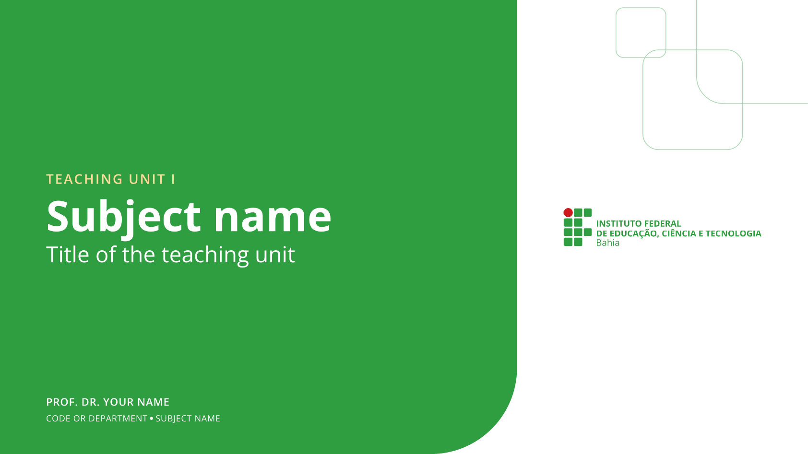
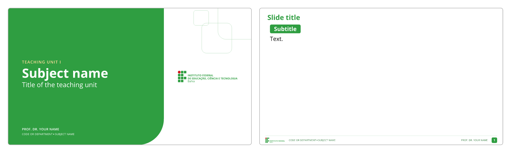
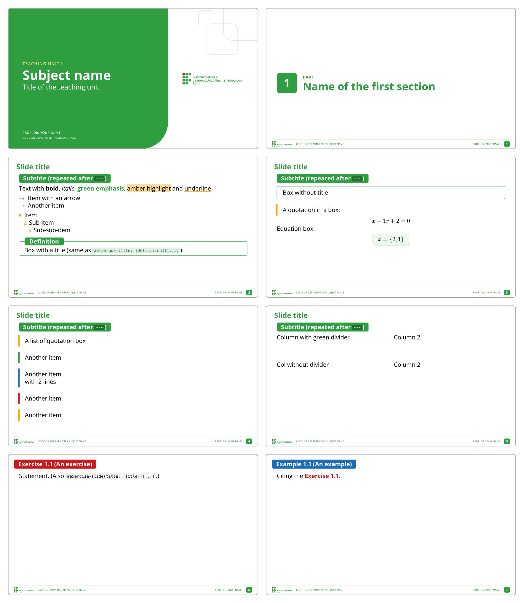

# touying-ifba-unofficial

<p align="center">
  <a href="docs/manual.pdf"></a>
  <a href="https://typst.app/"></a>
  <a href="https://typst.app/universe/package/touying"></a>
  <a href="LICENSE"></a>
</p>

<p align="center">
  <em><a href="https://touying-typ.github.io/">Touying</a> slide theme in <a href="https://typst.app/">Typst</a> for the <a href="https://portal.ifba.edu.br/">Federal Institute of Bahia (IFBA)</a>, Brazil.</em>
</p>

<p align="center">
  
</p>

## Installation

The theme is not on Typst Universe: a script installs it into the `local` namespace of Typst.

macOS and Linux:

```sh
curl -fsSL https://raw.githubusercontent.com/lucaslrodri/touying-ifba-unofficial/main/scripts/install.sh | sh -s -- --fonts
```

Windows (PowerShell):

```powershell
& ([scriptblock]::Create((irm https://raw.githubusercontent.com/lucaslrodri/touying-ifba-unofficial/main/scripts/install.ps1))) -Fonts
```

`--fonts` / `-Fonts` also installs *Open Sans*, the font of the theme, into the fonts folder of the user; leave it out
if the font is already installed. From a clone of the repository, run `sh scripts/install.sh` or
`.\scripts\install.ps1` instead; `--uninstall` / `-Uninstall` removes the package.

## Basic usage

```sh
typst init @local/touying-ifba-unofficial:0.1.0
```

creates a deck from [template/main.typ](template/main.typ), the cover and one slide. The font *Open Sans* must be
installed (see [Dependencies](#dependencies)).

<!-- template:begin (generated from template/main.typ by scripts/readme.sh: do not edit by hand) -->
```typst
// Starting deck for the touying-ifba-unofficial theme. Syntax: package README; every element: example/main.typ.
#import "@preview/touying:0.7.4": *
#import "@local/touying-ifba-unofficial:0.1.0": *

#show: ifba-theme.with(
  aspect-ratio: "16-9",
  lang: "en",   // "pt-br" (default), "en" or "es"
  config-info(
    title: [Title of the teaching unit],
    subtitle: [Teaching unit I],
    author: [Prof. Dr. Your Name],
    subject: [Subject name],
    subject-code: [CODE or Department],
    counter-prefix: [1.],   // "Exercise 1.N"; none gives "Exercise N"
  ),
)

#title-slide()

== Slide title
=== Subtitle

Text.
```


<!-- template:end -->

`config-info` fills the cover and the footer (on the cover, the footer texts go to the bottom of the green panel):

| Field | Where it goes |
| ----- | ------------- |
| `subject` | main line of the cover; footer, on the left, after the code ("CODE • SUBJECT") |
| `subtitle` | above the subject on the cover (light amber small capitals) |
| `title` | below the subject on the cover (white) |
| `author` | bottom of the cover panel; footer, on the right |
| `subject-code` | footer, on the left |
| `counter-prefix` | "Exercise 1.N" / "Example 1.N"; `none` gives "Exercise N" |

Options of `ifba-theme`: `aspect-ratio` (`"16-9"`, `"4-3"`, anything Touying's `utils.page-args-from-aspect-ratio`
accepts), `lang` (`"pt-br"`, `"en"` or `"es"`), `exercise-name`, `example-name` and `part-name` (override the localized
names), `footer-left` and `footer-right` (content or `self => ...`).

## Example

[example/main.typ](example/main.typ) shows the elements of the [syntax](#syntax) in a short deck:

<!-- example:begin (generated from example/main.typ by scripts/readme.sh: do not edit by hand) -->
```typst
// Example deck of the touying-ifba-unofficial theme: the elements of the syntax at a glance (details: package README).
#import "@preview/touying:0.7.4": *
#import "@local/touying-ifba-unofficial:0.1.0": *

#show: ifba-theme.with(
  aspect-ratio: "16-9",
  lang: "en",                         // "pt-br" (default), "en" or "es": text language and pill/section names
  // exercise-name: [Exercise], example-name: [Example], part-name: [Part],   // override the localized names
  config-info(
    title: [Title of the teaching unit],
    subtitle: [Teaching unit I],
    author: [Prof. Dr. Your Name],
    subject: [Subject name],
    subject-code: [CODE or Department],
    counter-prefix: [1.],
  ),
)

#title-slide()

= Name of the first section
// Content right after `=` goes to the right of the section slide, flush with the page edge (usually an image):
// #image("figure.png")

== Slide title
=== Subtitle (repeated after `---`)

Text with *bold*, _italic_, ~~green emphasis~~, ==amber highlight== and ~underline~.

-> Item with an arrow
-> Another item

- Item
  - Sub-item
    - Sub-sub-item

> == Definition
> Box with a title (same as `#emph-box(title: [Definition])[...]`).

---

> Box without title

"A quotation in a box."


$ 
x -3x + 2 = 0 
$

Equation box:

> $
x = {2, 1}
$

---

"A list of quotation box"
"Another item"
"Another item \
with 2 lines"
"Another item"
"Another item"

---

#cols(divider: true)[
  Column with green divider
][
  Column 2
]

#v(3em)

#cols[Col without divider][Column 2]

== An exercise <exercise-a>

Statement. (Also `#exercise-slide(title: [Title])[...]`.)

== An example <example>

Citing the @exercise-a.
```


<!-- example:end -->

## Syntax

### Headings and slide breaks

| Markup                          | Effect                                                                                       |
| ------------------------------- | -------------------------------------------------------------------------------------------- |
| `= Title` + `#image(...)`       | Section slide: the part number in a green square, "Part" (`Parte` in Portuguese and Spanish) and the title; the content right after `=` sits on the right, flush with the page edge (`#pad(right: 1.8em)[...]` restores a margin) |
| `== Title`                      | New slide with a green header                                                                 |
| `== Title <exercise>`           | Exercise slide: red pill "Exercise 1.N (Title)" (`Exercício`/`Ejercicio`), numbered automatically; `<exercise-id>` makes it citable with `@exercise-id` |
| `== Title <example>`            | Example slide: blue pill "Example 1.N (Title)" (`Exemplo`/`Ejemplo`), independent counter; `<example-id>` likewise |
| `=== Subtitle`                  | Green pill, no new slide; repeated at the top of every `---` continuation                     |
| `==== Subtitle`                 | Same pill, not repeated                                                                      |
| `---` (alone on a line)         | Next page of the same slide (same header, same pill, same number)                            |

Functions: `#title-slide()`, `#slide[...]`, `#empty-slide[...]` (footer only), `#exercise-slide(title:, color:)[...]`,
`#example-slide(title:, color:)[...]`. Touying's `#pause`, `#uncover`, `#only`, `#alternatives`, `#speaker-note`,
`#slide(composer:)` etc. work as usual.

### Inline formatting

| Markup                     | Result                                                                                   |
| -------------------------- | ---------------------------------------------------------------------------------------- |
| `*text*` / `_text_`        | black bold / black italic (bold takes the box color inside `emph-box`, white inside pills) |
| `#alert[text]`, `~~text~~` | green bold (light amber inside pills)                                                    |
| `==text==`, `#highlight[...]` | light-amber background (`#highlight(fill: colors.quaternary-lighter)` for other tones) |
| `~text~`, `#underline[...]` | strong amber underline (box color inside `emph-box`)                                   |
| `#primary`, `#secondary`, `#tertiary`, `#quaternary` | bold text in green / amber / red / blue                       |
| `` `code` ``               | gray chip; inside titles, boxes and pills it follows the container color                 |
| `#icon("name", color: auto, size: 1em)` | one of 320 Octicons, colored by context                                    |

Escapes: `\==x==`, `\> text`, `-\> item`, `\~text\~`, `\"quote\"`. No shorthand is applied inside `raw`.

### Lists and terms

| Markup                                  | Result                                                    |
| --------------------------------------- | --------------------------------------------------------- |
| `-> item` (start of a paragraph)        | list with a green `→` marker (`#arrows(color:)[...]` recolors it) |
| `- item` / `  - sub` / `    - sub`      | amber filled square / rotated hollow square / small circle |
| `+ item` / `  + sub` / `    + sub`      | `1.` / `a)` / `i.`, green and bold; `#set enum(numbering: "a)")` starts at `a)` |
| `/ Term: description`                   | bold term, colon, line break                              |

### Boxes, quotes and columns

```typst
#emph-box[...]                                        // thin green border; `color:` for another family
#emph-box(color: colors.quaternary, title: [Title])[...]   // badge over the top border
$ #eq-box[$E = m c^2$] $                              // equation box, inside the equation (`color:` optional)
#quote-box(color: colors.secondary)[...]              // vertical bar on the left
#cols(divider: true, columns: (1fr, 2fr))[A][B]       // Touying's cols, optional green divider
```

Markdown-like short forms (inline content only, always primary):

```
> Box without title.

> == Title
> Box with title.

> $ y = phi(v) $        // `>` before a block equation (same line or the line above): equation box

"A quotation."          // paragraph made only of quoted lines → one quote box per line
```

### Colors

`colors` has five families (`primary` `#2F9E41`, `secondary` `#F7A800`, `tertiary` `#CD191E`, `quaternary`
`#1C6DB8`, `neutral` `#808080`) × seven tones (`-darkest`, `-darker`, `-dark`, base, `-light`, `-lighter`,
`-lightest`), e.g. `colors.primary-lighter`. The same keys are available as `self.colors.*`.

## Documentation

The full documentation is the [manual](docs/manual.pdf) (PDF), set with the rules of the theme itself.

## Dependencies

| Dependency | Version | Role |
| ---------- | ------- | ---- |
| [Typst](https://typst.app/) | ≥ 0.14 | compiler |
| [touying](https://typst.app/universe/package/touying) | 0.7.4 | slide engine (the deck imports it too) |
| [codly](https://typst.app/universe/package/codly) | 1.3.0 | code blocks, re-exported by the theme |
| [linguify](https://typst.app/universe/package/linguify) | 0.5.0 | localized names |
| *Open Sans* | | font, installed on the system (not bundled with Typst, unlike *New Computer Modern Math*, used for the equations) |

The packages are fetched automatically. The font is not: [Open Sans](https://fonts.google.com/specimen/Open+Sans) is
the typeface of the brand of the Institutos Federais, under the SIL Open Font License. The installer downloads it with
`--fonts` / `-Fonts`; otherwise install it on the system, or keep the `.ttf` files in a folder and compile with
`typst compile --font-path <folder> main.typ`. In the [Typst web app](https://typst.app/), upload the `.ttf` files to
the project: fonts inside the project are found automatically.

## License

The theme is licensed under the [MIT License](LICENSE). The contents of [template/](template/) are licensed under
[MIT No Attribution](LICENSE-MIT-0) (MIT-0), so a deck created from the template can be used and shared without
restriction, with no attribution required.

Third-party components: the icons in [src/icons.typ](src/icons.typ) are [Octicons](https://primer.style/octicons/),
© GitHub Inc., licensed under the MIT License.

The IFBA logo ([assets/ifba-logo.svg](assets/ifba-logo.svg), [assets/ifba-logo-short.svg](assets/ifba-logo-short.svg))
is the property of the [Federal Institute of Bahia](https://portal.ifba.edu.br/) and is not covered by the licenses
above; the theme is used for academic purposes. The files are the official artwork, but the theme draws the lettering
of the logo in green, which is a choice of the theme and not an official version of the brand. This theme is
unofficial: it is not affiliated with or endorsed by the institute.

The theme is the sibling of [touying-ufac-unofficial](https://github.com/lucaslrodri/touying-ufac-unofficial), with
which it shares the syntax.
